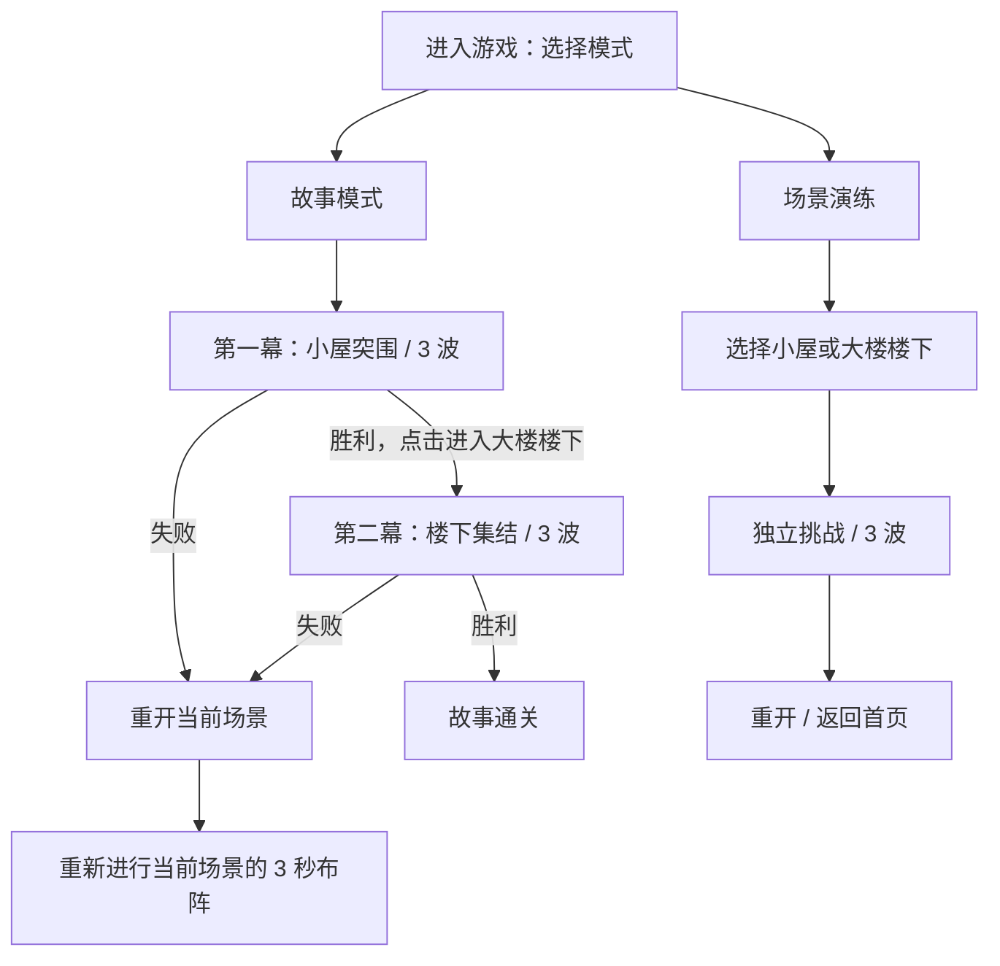

# 故事与场景设计稿

本次方案把“场景内容”和战斗规则分开。玩家进入游戏先选择故事模式或场景演练；故事模式从小屋开始，完成小屋三波后进入大楼楼下。每个场景只安排三波，第三波全部生成并清场、至少一名人类存活才算通关。

配套的 [可交互设计预览](design/scenes-preview.html) 可直接用浏览器打开，查看入口、场景卡片、小屋与大楼楼下的俯视布局。预览是流程与空间设计稿，战斗仍在 Cocos 的 `Battle.scene` 中运行。

## 1. 入口与章节流程



- **故事模式**：强调从室内突围到室外街区的连续体验。第一关结算保留用时和存活人数，显示“进入大楼楼下”；点击后开始第二关的 3 秒布阵。第二关胜利显示“故事通关”。
- **场景演练**：显示地图缩略图、地点、场景名、三波目标，两个场景均可直接选择；演练胜利后不触发故事跳关。
- **战斗页面**：显示模式、当前场景、人类/僵尸数量、`第 n/3 波`、用时，以及暂停、重新开始、返回首页。失败时只能重试或返回，不能进入下一关。
- **本版衔接规则**：每关重新生成当前默认人数的队伍，使用现有兵种与数值设置。重开仍是当前关。过关、选关和重开时清空旧子弹、选中单位、指令预览、波次动画和事件游标。
- **进度规则**：本版为一次会话内的顺序推进；返回首页后重新选择故事，从第一关开始。解锁、跨次存档、伤兵继承和成长系统留给后续单独设计。

现有 `LV01_zombie_wave` 配置本来就是三波，不能把“50 名士兵”“第一波 50 只僵尸”或每波的多个出怪批次当成 50 波。本次两张地图都明确配置为三波，保留已有的每批 5 只、每秒一批规则。

## 2. 场景一：小屋突围（已接入）

**地点与情绪**：临时落脚的小屋内部。先在熟悉的小空间站稳，再打开通往外部的路线。保持当前版本地图的墙体位置、通路和第一关波次，避免扩展场景时同时重做原关卡。

**视觉**：深灰地面，中央略亮的室内地板，灰色细隔墙，绿色士兵和紫色僵尸。背景与装饰不参与碰撞；墙体矩形同时用于显示、移动阻挡和射线判断。

**地形**（地图原点在左上，尺寸 1080×2400，以下均为地图像素）：

| 墙体 | 左上角 | 宽 × 长 | 作用 |
|---|---|---|---|
| 西隔墙 | (350, 900) | 40 × 360 | 分隔西侧与中央空间 |
| 东隔墙 | (690, 900) | 40 × 360 | 与西墙形成中央走廊 |
| 北隔墙 | (420, 1060) | 240 × 40 | 提供短暂遮挡并迫使绕行 |
| 南短墙 | (260, 1600) | 100 × 40 | 为后撤提供方向变化 |

**三波节奏**：

| 波次 | 战斗时间 | 数量与方向 | 体验目标 |
|---|---|---|---|
| 1 | 0 秒 | 50 只，北/南各 13，东/西各 12 | 观察四侧压力与固定圆选兵 |
| 2 | 7 秒 | 100 只，四侧各 25 | 集结火力，避免被墙分散 |
| 3 | 20 秒 | 200 只，四侧各 50 | 利用后撤与绕墙维持队形 |

开始时间不等待前一波清场。上述为波次宣告时间，生成按现有分批规则进行；等待第三波所有批次生成并消灭剩余僵尸后才结算。

第一关直接复用工作区现有波次配置；当前第二、三波北侧还包含胖僵尸、僵尸母体，总数仍为上表的 50/100/200。兵种比例与感染等行为继续由现有战斗模块负责，场景扩展不重写这些规则。

**过关文案**：“小屋已守住，前往大楼楼下。”这是章节转换节点；下一关重新布阵，避免玩家在弹窗还未看完时被立即投进尸群。

## 3. 场景二：楼下集结（已接入）

**地点与情绪**：离开小屋后抵达大楼楼下的开放区域。四块建筑基座夹出纵向街道和横向广场，空间由“细墙隔断”变为“宽厚建筑形成的街角”。

**视觉**：蓝灰色路面、略亮的十字通道、混凝土建筑矩形、中央断续道路标线。建筑以矩形轮廓表达，避免圆形或接近正方形的障碍物。装饰标线没有碰撞。

**布局**：

```text
                     北侧来敌
        ┌─────────┐           ┌─────────┐
        │ 西北大楼 │ 纵向街道  │ 东北大楼 │
        │ 240×620 │  宽280    │ 240×620 │
        └─────────┘           └─────────┘
 西侧来敌 ←       集结广场 / 横向通道        → 东侧来敌
        ┌─────────┐           ┌─────────┐
        │ 西南大楼 │  后撤路   │ 东南大楼 │
        │ 240×480 │           │ 240×480 │
        └─────────┘           └─────────┘
                     南侧来敌
```

| 建筑墙体 | 左上角 | 宽 × 长 | 与原隔墙比较 |
|---|---|---|---|
| 西北大楼 | (160, 460) | 240 × 620 | 比 40×360 的竖墙更宽、更长 |
| 东北大楼 | (680, 460) | 240 × 620 | 对称形成 280 像素的中央通道 |
| 西南大楼 | (160, 1480) | 240 × 480 | 比小屋竖墙更宽、更长，留出南侧回转空间 |
| 东南大楼 | (680, 1480) | 240 × 480 | 提供东南方向的转角与遮挡 |

横向通道位于 y=1080–1480，净宽 400；纵向通道位于 x=400–680，净宽 280；两侧外围各保留 100 像素步行带。队伍初始部署在 (420,1280)、(540,1280)、(660,1280) 附近。所有初始单位和四边出生点都在墙外。

**玩法重点**：

- 宽墙使射击视线中断得更明显。守在街角可缩小同时接敌的范围，但向墙后移动也可能让士兵暂时失去火力覆盖。
- 敌人从南北进入时，中央街道形成长轴压力；东西夹击迫使玩家选择向南/北撤离，而不能一直停留在十字中心。
- 继续使用现有墙体规则：阻挡移动与子弹、可绕行，三只僵尸堆叠后可翻墙。大楼矩形在此原型中作为可翻越的建筑墙体障碍；不可翻越的整栋建筑需要另行增加地形能力，当前没有暗中更改翻墙机制。

**三波节奏**（新增关卡的初始调参值）：

| 波次 | 战斗时间 | 数量与方向 | 体验目标 |
|---|---|---|---|
| 1 | 0 秒 | 30 只，北/南各 15 | 认识街道与建筑遮挡 |
| 2 | 14 秒 | 45 只，西/东/北各 15 | 首次侧面包夹，调整街角站位 |
| 3 | 30 秒 | 60 只，四侧各 15 | 四向压力下沿街转移并清场 |

总计 135 只。第二关以宽墙和射线遮挡形成变化，当前数量是可调的起点，不能当成已经通过人工试玩的难度结论。

**通关文案**：“楼下区域已清理，队伍暂时安全。”当前故事在第二幕结束，提供重开和返回首页。

## 4. 后续场景内容提案（设计储备，未进入关卡列表）

| 场景 | 地形与视觉 | 第一波 | 第二波 | 第三波 | 核心决策 |
|---|---|---|---|---|---|
| 地下停车场 | 低照度、长方形停车岛、立柱、入口坡道；以地面标线区分通道 | 坡道正面进攻，学习入口射线 | 两侧通道出现尸群 | 坡道与侧路同时进攻 | 分配火力守路口，保留一条后撤通道 |
| 商业街 | 长条店铺外墙、连续街角、少量短掩体；霓虹色点缀 | 街道一端直线推进 | 两个巷口夹击 | 街道两端与巷口同时进攻 | 逐段转移，避免追击时拉长队形 |
| 撤离广场 | 开阔地面、长方形公交站与围栏、北侧撤离平台 | 少量散兵从外围逼近 | 主要压力转移到撤离方向 | 四边最后合围 | 在“守住火力点”和“保持撤离通道”之间分配队伍 |

上述提案沿用每场三波，不在本次原型里实现护送目标、视野迷雾、可破坏车辆或撤离倒计时。先用现有移动、寻路、遮挡和胜负条件验证地形差异，再决定是否增加新规则。

## 5. 场景扩展方式

场景模块在 `src/scenes/`，统一实现 `SceneDefinition`：

- `id / title / subtitle / briefing / objective`：入口、卡片、HUD 与结算文案。
- `mapId / map`：设计尺寸、战斗边界、选兵半径、初始部署点、出生点、矩形地形。
- `levelId / level`：场景自己的三波时间、敌人类型、来源、数量、分批大小与间隔。
- `presentation`：地面、墙体、轮廓颜色与无碰撞装饰。

第一关模块复用现有 `config/map.json` 和 `config/levels.json`。第二关集中于 `config/scenes/courtyard.json`，由 `src/scenes/courtyard.ts` 导出。增加第三关时：

1. 在 `config/scenes/` 新建场景 JSON，定义三波、地图和文案。
2. 在 `src/scenes/` 增加对应模块，并加入 `index.ts` 的 `SCENES` 列表；顺序即故事推进顺序。
3. 地图加载、波次加载、场景卡片、下一关判断都从列表派生；地图绘制与输入从当前战斗的 `MapModel` 读取。
4. 执行 `npm run sync:core`、本次场景回归、两项类型检查和 bundle 检查。生成目录不手工修改。

只有一份 Cocos `Battle.scene`，它作为通用战斗容器；增加一个地点不需要复制整套控制器或另造一套战斗系统。现有的 `MapModel.register`、`WaveManager.register` 接口继续可用。

## 6. 验证与试玩要点

自动回归重点：菜单冻结时钟与战场输入、真实按钮进入故事/演练、三波配置有效、胜利前不能跳关、故事的下一关与末关结算、演练不自动推进、重开当前场景、切换时清空旧显示，以及宽墙的移动/射线阻挡和可绕行路径。

本次实际执行结果及综合回归中的旧断言失败见 [场景扩展验证记录](testing/scenes-test-report.md)。

Creator 试玩重点：入口与场景卡片的中文换行、不同屏幕下点击区域、小屋到室外的视觉差异、街角射击中断是否清楚、建筑周边绕行与翻墙表现、三波实际难度。自动测试和静态预览不替代这些引擎内观察。
