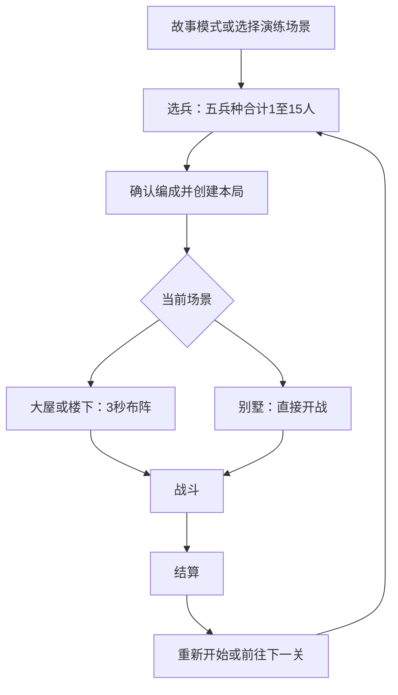

# 战斗编成、场景显示、编队操作与节奏调整设计

> 状态：已实现，2026-10-19。两轮玩法确认后，用户补充白闪只作用于僵尸自身，并授权开发。核心、开局界面和 Cocos 适配层已接通；自动化验证与实机待验范围见第9节。
>
> 适用范围：大屋守卫、楼下集结、别墅解救三个已有场景，以及通用的开局、输入和受击表现流程。本次涉及的旧规则以本文的已确认决定为后续修改依据；其他规则继续参考现有实现和场景规格。

相关文档：[现有兵种与战斗规格](12-followup-implementation-spec.md) · [别墅实现规格](13-villa-civilian-rescue-implementation-spec.md) · [开发与配置约定](development.md)。

## 1. 已确认决策与实现取值

### 1.1 用户已确认

| 编号 | 已确认决定 | 具体边界 |
|---|---|---|
| D01 | 喷火兵可以持续喷火 | 取消喷火兵的过热和冷却停顿；站定且有有效目标时持续喷射 |
| D02 | 保留移动时的收火与放火 | 移动前收火 `0.30s`，到达后放火 `0.25s`；此过程沿用现有伤害暂停规则 |
| D03 | 每局开始前自由选择五兵种数量 | 步枪兵、喷火兵、盾兵、狙击兵、工兵分别选择，合计 `1～15` 人 |
| D04 | 战场约占屏幕面积的 50%，居中显示 | 士兵、僵尸、建筑、平民、弹道和场内特效随战场等比缩小 |
| D05 | 普通拖动移动整队，长按拖动移动单兵 | 原地长按 `0.45s` 后进入单兵模式；拖动开始后锁定模式，不因拖动时间变长而切成单兵 |
| D06 | 靠近的士兵自动组队 | 相距 `120` 个地图像素以内可自动成队，隔墙不组队 |
| D07 | 整队优先一起移动 | 共享目标，尽量保持相对站位，按最慢士兵速度行进；喷火兵收火、工兵拆卸结束后一起出发 |
| D08 | 大屋生成稍慢一点 | 每批仍为 `10` 只，间隔 `0.50s → 0.60s`，名义速率降低约 `16.7%`；总数仍为 `700` |
| D09 | 各场景统一限制生成速率 | 楼下和别墅先沿用现有节奏；增加通用生成限速，避免同一时刻集中补刷多批 |
| D10 | 僵尸受击变白 | 实际受到伤害时只让该僵尸本体短暂白闪，场景背景及其他单位保持原色 |

### 1.2 开发时采用的补充细节

以下属于授权开发后采用的实现取值；它们补充已确认玩法，不另标为用户逐项确认的数值。

| 项目 | 当前采用值 | 原因 |
|---|---|---|
| 首次进入的默认阵容 | 大屋、楼下默认 `4步枪 + 2喷火 + 1盾 + 1狙击 + 1工兵 = 9人`；别墅默认 `4步枪 + 2喷火 + 1盾 = 7人` | 以当前各场景阵容作为选兵页起点，上限提高不等于默认补满15人 |
| 阵容记忆 | 本次游戏会话内按场景记住上次选择；重开时预填，仍可调整；跨启动保存留待后续 | 减少重复操作，并保持每局开局都能选兵 |
| 组队稳定参数 | 每 `0.20s` 复核一次，成队距离 `120`，已有连接超过 `160` 才拆开 | 避免边缘抖动导致队伍频繁变化 |
| 手势移动阈值 | `8` 个屏幕逻辑像素 | 阈值跟随触摸显示坐标，缩小地图后仍保持一致手感 |
| 最小选兵触摸半径 | `18` 个屏幕逻辑像素，并优先选择距离最近者 | 缩小后视觉身体较小，需要扩大触摸容错 |
| 白闪参数 | 持续 `0.10s`，同一僵尸两次白闪起点至少相隔 `0.15s` | 保留原兵种颜色的可见窗口，避免密集火力下持续纯白 |

## 2. 修改前的实现基线

本节保留开发前的源码与 JSON 基线，便于解释变更。当前规则以第3至8节为准。

| 内容 | 修改前行为 | 本次调整 |
|---|---|---|
| 喷火兵 | 射程 `220px`，每 `0.15s` 造成一次 `14` 点锥形伤害；会积热、过热并冷却；移动时收火，到达后放火 | 去掉强制过热停顿，持续攻击使用原伤害节奏 |
| 默认士兵 | 通用上限 `MAX_HUMANS=9`；大屋、楼下默认9人；别墅从场景配置读取固定7人及站位 | 新增每局选兵，并统一15人上限及动态站位 |
| 场景显示 | `1080×2400` 逻辑地图适配安全区与HUD预留空间，场内视图共用父节点 | 改为约半屏面积并居中，输入同步使用新的坐标变换 |
| 选兵移动 | 每次按下只捕获最近的一名士兵；拖动松手发出移动命令 | 自动编队、整队拖动、长按单兵、整队运动协调 |
| 大屋生成 | `0/7/20s` 开启三波，分别 `100/200/400`，每批10只、间隔0.5s | 每批间隔改0.6s，并受同一个场景生成限速器约束 |
| 楼下生成 | 连续720只，每0.35s一批10只；北/南各30%，东/西各20%；巨胃占5% | 保留节奏，接入通用限速 |
| 别墅生成 | 连续240只，每批1只；间隔在60s内从0.6s降至0.2s，四侧均衡 | 保留节奏与加速规则，接入通用限速 |
| 受击表现 | 有弹道命中、士兵受到近战后的脉冲等反馈；没有僵尸本体统一白闪 | 从真实伤害事件驱动僵尸白闪 |

喷火配置虽然保留了 `attack_interval_s=0.45` 和 `continuous_duration_s=0.45`，当前正常战斗使用的是 `CombatSystem.updateFlamethrower()` 的附着锥形火焰。停顿主要由热量状态机控制，不能只把攻击间隔改成零。伤害计算仍需保留 `0.15s` 的 tick，确保伤害不随显示帧率增加。

## 3. 喷火兵持续喷射

### 3.1 玩家可见行为

1. 静止且有射程内、无遮挡的有效僵尸时，完成 `0.25s` 放火后持续喷射。
2. 目标死亡但仍有其他有效目标时，直接转向并继续喷射，不重新等待放火。
3. 目标全部离开有效范围时收火；重新遇敌后放火。
4. 收到整队或单兵移动命令时先收火 `0.30s`。移动期间不造成火焰伤害，到达后有目标则重新放火。
5. 不再因过热停火，不显示喷火兵的过热/冷却等待条；收火、放火的进度反馈保留。

### 3.2 战斗与配置边界

- 保留射程220、范围宽度参数42、每tick伤害14、tick间隔0.15s和现有遮挡判定。持续喷射对应理论每目标约 `93.3 HP/s`，实际取决于目标是否在锥形范围内。
- 一个喷火兵每个tick对同一目标最多结算一次；多个喷火兵各自造成真实伤害。目标切换不额外赠送一个伤害tick。
- 用 `config/units.json` 的 `flamethrower.overheating_enabled=false` 控制本轮持续模式；未设置或为true时沿用热量玩法。
- 喷火兵不进入过热/冷却状态，残留热量和倒计时在开局清零。工兵继续使用自己的热量和冷却规则。
- 暂停、结算、死亡和离开场景均停止伤害；表现层只绘制火焰，不自行触发伤害。

## 4. 每局开始前选择士兵

### 4.1 页面与流程

选兵页显示场景名、五种兵种的颜色和名称、每种数量的加减按钮、总人数 `N / 15`，以及“开始战斗”和“返回”。总数为15时各兵种加号禁用，总数为0时开始按钮禁用。

“每局开始之前”覆盖故事首关、演练选关、重开和故事下一关。选兵期间不启动本局战斗计时，也不预生成僵尸。取消选兵返回原入口，结算后的阵容只在确认开始后用于新一局。

### 4.2 数据校验

- 编成保存为五兵种的确切整数数量，不能用权重循环近似玩家选择。各数量均为非负整数，总和必须在1到15之间。
- UI禁用与核心校验同时存在；直接调用核心传入非法编成也应明确拒绝，不能静默截断成15人。
- 正式开始时复制编成快照，战斗中修改选兵页的数据不改变已经上场的士兵。
- 开局数量、HUD分母、存活统计和结算使用实际编成；去掉别墅固定返回“7人”的分支。
- 15人指开局可部署士兵总数，五兵种共享上限；平民与僵尸不占士兵名额。减员后不自动补兵。

### 4.3 初始站位

大屋、楼下沿用当前中央部署区域，按所选人数生成不重叠且合法的初始站位；15人时仍需保证士兵的实体半径不嵌墙。

别墅在 `config/scenes/villa-rescue.json` 的 `level.soldierPositions` 中保留原7个防守位并补至15个。按照五兵种顺序展开确切编成，依次使用合法站位；不额外提供兵种位置交换。站位与平民至少相距55地图像素、与其他士兵至少相距50地图像素，并按最大士兵半径检查地形。选兵预览和实际部署共用 `Roster.soldierPositions()`，保护目标仍为原位置的中央6名平民。

## 5. 半屏面积、居中的战场显示

### 5.1 缩放口径

用户确认的是“屏幕面积约50%”。参考安全显示区域计算目标面积，再依据地图比例和HUD空间约束等比适配。

| 对比 | 相对完整同形区域的宽、高 | 面积 |
|---|---:|---:|
| 已选：面积减为一半 | 各约 `70.7%` | `50%` |
| 宽、高各减为一半 | 各 `50%` | `25%` |

以无额外约束的 `1080×2400` 安全区为示例，地图显示约 `764×1697`，中心仍在 `(540,1200)`。这是口径示例，实际设备需根据安全区、HUD和长宽比计算。

候选缩放系数：`s = sqrt(0.5 × 安全区宽 × 安全区高 / (地图宽 × 地图高))`。再用可容纳的宽、高限制 `s`，使战场矩形完整可见，且中心与安全区中心对齐。宽屏或HUD约束导致无法达到50%时优先完整显示，不能拉伸地图或裁掉出生入口。验收记录实际面积比例。

### 5.2 一起缩放的内容

地图地面、装饰、墙、门窗、士兵、僵尸、平民、武器、火焰、弹道、受击白闪、场内状态条、选择轮廓和移动预览统一使用战场变换。HUD、按钮和选兵页在独立UI层维持可读尺寸。

逻辑地图保持1080×2400。实体位置、碰撞半径、射程、移动速度和出生区域继续用地图坐标计算；画面缩小后屏幕上的移动距离也随之缩小，同一条路线的行进时间保持一致。

输入使用同一个最终变换反算地图位置。按下必须落在战场矩形内；从战场内拖到边缘时，目标按现有规则投影到合法位置；拖到HUD、取消、切后台或布局变化则清理手势。留白区域不能作为选兵和移动手势的起点。

选中优先找最近士兵，命中容错取现有地图选择半径与最小屏幕触摸半径中较大的值。组队距离始终按地图像素计算，不能因屏幕大小而改变成员。密集士兵需要真机验证长按是否容易锁定预期对象。

## 6. 自动组队与两种拖动

### 6.1 队伍形成与稳定

- 仅存活、有效的人类士兵参与。平民、尸体和僵尸不参与。
- 两名士兵中心距离不超过120地图像素，且之间没有阻挡移动的地形，可建立同队连接。完整墙、关闭门窗都阻止连接；破坏后再根据距离连接。
- 用连接关系的连通分量形成队伍。例如A靠近B、B靠近C，则ABC同队，即使AC超过120。
- 每0.20s更新，现有连接在超过160地图像素或出现阻挡时解除。成员变化不自动产生移动命令。
- 按下时以轮廓突出本次选择的全部成员，战场上方显示“整队移动 · N 人”；长按成立后改为白色选择圈与“单兵移动 · 1 人”。标记保留兵种颜色。

### 6.2 手势判定

| 阶段或操作 | 选择与反馈 | 是否发移动命令 |
|---|---|---|
| 按下士兵 | 锁定最近单兵ID及其当前队伍成员快照，显示整队预览 | 否 |
| 在0.45s之前移动超过拖动阈值 | 锁定整队模式，显示目标箭头及选中成员 | 松手后发送 |
| 原地保持至0.45s | 锁定单兵模式，只保留该士兵高亮，显示“单兵移动”提示 | 再拖动并松手后发送 |
| 短按后原地松开 | 只显示选择反馈 | 否 |
| 长按后原地松开 | 只显示单兵选择反馈 | 否 |
| 任意模式拖动超过0.45s | 保持已经锁定的模式 | 松手后发送 |
| 空白起手、触摸取消、第二根手指 | 不采集路径上的士兵；其他手指不抢占本次手势 | 否 |

长按计时使用单调的真实时间；移动阈值用屏幕逻辑像素计算，不能按缩小后的地图像素计数。恰好到阈值时先按事件时间处理长按成立，再处理后续拖动，保证边界行为可测试。

按下时捕获的ID在整次手势中保持稳定，期间路过的士兵不会被加入。松手时由核心过滤已经死亡或失效的ID；若全部失效，则不发送命令。

### 6.3 整队移动

1. 根据所选成员质心计算相对站位，将质心移动到玩家指定目标附近，各成员保留自己的目标偏移。
2. 目标靠墙或靠边时整体平移或压紧可用队形，并按实体半径验证。狭窄通道允许临时变形，通过后再向目标队形归拢。
3. 移动速度取本次有效成员的最低速度。喷火兵收火、工兵拆卸完成后才统一开始平移，期间保留各兵种允许的战斗行为。
4. 成员死亡则移出本次协调计划；不会因为死人或已失效单位一直等待。路径不可达时清除移动目标并回到待命，不可穿墙或瞬移到队形点；当前没有另加失败提示弹窗。
5. 运动中的本次成员保持命令归属，避免暂时拉开距离就更换队伍或顺路带走其他士兵。命令结束、取消或被替换后再按邻近规则更新。
6. 后续整队指令替换同一批成员的目标；若收火/拆卸已经开始，不重复重置进度。

### 6.4 单兵脱离与重组

长按锁定的单兵暂时脱离整队移动协调，其他成员继续执行原有目标；其个人速度和武器移动规则照常生效。单兵移动完成后重新参与邻近组队，靠近新队伍即可加入。

单兵命令只发送这一名士兵ID。既有实体互相挤开的微小位移属于碰撞处理，不等于其他士兵也收到移动命令。

## 7. 生成减速与统一限速

### 7.1 各场景目标

| 场景 | 本次生成节奏 | 名义速率/上限 | 总数与入口 |
|---|---|---|---|
| 大屋 | 三波仍在0/7/20s开启；每批10只，间隔0.60s | 单批节奏约16.67只/s；所有波次共享节奏限制 | 700只；南北入口和敌人组成沿用配置 |
| 楼下 | 连续模式，每批10只，间隔0.35s | 约28.57只/s | 720只；北南各30%、东西各20%，巨胃5% |
| 别墅 | 连续模式，每批1只；60s内0.60s线性降至0.20s | 约1.67只/s升至5只/s | 240只；四侧均衡 |

名义速率是“批量/间隔”，不是任意一秒窗口内都不能多于这个小数。首批允许在战斗时间0生成，整数批次可形成短脉冲；实际约束由批量上限和最短批间隔共同定义。

大屋在无额外延迟的情况下，各波最后一批约在 `5.4s / 18.4s / 43.4s` 出现；当前约为 `4.5s / 16.5s / 39.5s`。这些是按批次计算的生成时间，不是关卡通关时间。

### 7.2 调度约束

- `WaveManager`负责波次时间与配置，`SpawnSystem`负责实际生成。出生位置继续来自 `map.spawnPoints`，不在战斗主流程按地图ID填写速度或比例。
- 同一场景的所有待生成队列共享限速状态；不能给每一波各自一份速率额度，叠波后总速率翻倍。
- 每个生成批次有数量上限和下一次最早允许生成的时间。若出现多批积压，按实际生成时刻重新安排后续间隔，不在同一个逻辑时刻追赶多批欠账。正常固定步进中的时间量化要单独验证，不能使连续模式的加速曲线累计偏移。
- 同一批分配到多个入口仍视为一次总批次，例如大屋总计10只，而不是南北各10只。楼下四边同一批的事件也合计最多10只。
- 连续模式实际间隔同时满足当前加速曲线与限速下限；别墅不能因为下限是0.20s就从开局直接按0.20s生成。
- 生成限速使用战斗逻辑时间，暂停和后台不积攒额外额度；不根据显示帧率或单次渲染update限制，以保持不同帧率下结果一致。
- 一次大步模拟内部仍可按固定50ms逻辑步推进正常生成；限速限制的是游戏时间内的频率。
- 排队数量不丢失、不算作已生成。全部实际生成完毕后才发布生成完成；胜利仍需清除剩余僵尸。
- 巨胃释放已有僵尸属于已有单位重返场上，不消耗新的生成额度；平民变身继续遵守其独立规则。

配置字段为 `level.spawnLimits = { maxBatchSize, minInterval_s }`。大屋对应10/0.60，楼下10/0.35，别墅1/0.20。批量必须为正整数、间隔必须为有限正数，非法值在加载阶段拒绝。限速与正常节奏同时约束实际入场，连续加速仍读取 `continuousSpawn`。

大屋权威配置是 `config/scenes/cabin.json`，`config/levels.json` 中兼容关卡已同步0.60s间隔与限速字段。楼下保留的旧waves不参与当前连续生成。

## 8. 僵尸受击白闪

### 8.1 触发与表现

统一消费核心的 `damage` 事件，只有目标为僵尸且 `appliedAmount > 0` 时触发。步枪、喷火、狙击、工兵、盾兵以及其他有效伤害来源都可触发同一种本体反馈；弹道飞过、撞墙、零伤害和吞入动作不触发。

白闪0.10s：前0.02s使用明亮白色，后0.08s逐步回到该僵尸原有颜色。闪白只作用于受伤僵尸的身体填色，特殊僵尸的尺寸、标记、轮廓继续可见；不会绘制场景白色遮罩。

同一僵尸两次白闪的起点至少间隔0.15s，白闪期间受击不延长当前白闪；所有实际伤害正常结算。这样多名喷火兵、机枪同时命中时不会把身体长时间锁成白色。

致命一击也触发白闪，并与现有死亡淡出共同绘制；不会为了展示白闪延迟核心死亡、击杀归属或胜负结算。暂停冻结白闪进度，重开、切关、吞入隐藏及移除实体时清理暂态。

### 8.2 工程边界

视图按单位ID保存有限的白闪状态，复用 `UnitView` 的共享绘制方式。一个僵尸最多保留一份当前状态，不为每次伤害创建节点或长期事件队列。显示计时使用可暂停的战斗表现时钟，结算后可完成已有淡出，不能重复消费最后一帧事件重新触发白闪。

## 9. 实现拆分与验收

### 9.1 模块分工

| 模块 | 已实现职责 |
|---|---|
| `src/core/config.ts`、`types.ts`、`BattleTestHarness.ts` | 15人上限、确切编成入参、动态初始人数与部署 |
| `src/adapter/BattleSession.ts`、`assets/scripts/adapter/HudController.ts` | 每局选兵流程、预填、确认开始与重开/下一关回选兵 |
| `assets/scripts/adapter/contracts.ts`、`BattleSceneController.ts` | 半屏面积布局、统一场景变换和坐标往返 |
| `InputManager.ts`、`src/core/SquadSystem.ts` | 长按状态机、稳定选择、自动组队、单兵脱离 |
| `CommandSystem.ts`、`MovementSystem.ts` | 相对队形、共同速度、出发等待与指令替换 |
| `CombatSystem.ts`、`config/units.json` | 喷火持续模式及现有tick伤害规则 |
| `WaveManager.ts`、`SpawnSystem.ts`、场景JSON | 大屋0.60s、通用批量/间隔限速、完成语义 |
| `src/core/Roster.ts` | 编成严格校验、三场景站位、预览与部署共用 |
| `UnitView.ts` | 真实伤害白闪、选中轮廓、清理与暂停 |

15人、持续喷火和大屋减速叠加后火力提高；难度评估应记录具体编成，不沿用旧版本通关时长或减员结论。

### 9.2 验收清单

| 范围 | 需要证明的行为 |
|---|---|
| 选兵 | 1/7/9/15人均准确生成；同兵种15人可用；0、16、负数、小数、非法兵种被拒绝；UI和核心一致 |
| 流程 | 故事首关、演练、重开、下一关都可选兵；选兵期间不推进本局时间；场景实际人数进入HUD和统计 |
| 初始部署 | 三场景支持1到15人；别墅平民不被挤走，士兵不嵌墙或门窗；原3s/0s部署规则正确 |
| 布局 | 安全区居中、等比且接近50%面积；场内对象同步缩放；多长宽比、窄屏和布局变化后的触摸坐标正确 |
| 手势 | 0.45s边界、拖动后长按不切换、取消、多指、空白、死亡成员、暂停和后台清理 |
| 自动组队 | 120距离内成队、隔墙分队、破门重组、边缘防抖、链式成员、运动中成员稳定 |
| 整队运动 | 按最慢速度、收火/拆卸后共同出发、个人目标有偏移、狭道不穿墙、重复指令不重置等待 |
| 单兵 | 只向该ID发命令；原队继续；单兵完成后可重组；目标死亡或失效时无错误命令 |
| 持续喷火 | 长时间有目标时不因热量中断；每目标每tick一次；转火不重复伤害；移动停止伤害；工兵过热有效 |
| 生成 | 大屋10/0.60及700总数；全部波次共享上限；大步模拟与正常分步一致；首批、暂停、重开和生成完成正确 |
| 白闪 | 按实际扣血触发；喷火tick有效；密集命中仍可见原色；致命一击、特殊单位、暂停、结算淡出和清理正确 |

实现阶段修改源码或配置后必须运行 `npm run sync:core`，不得手改 `assets/scripts/generated/core.js`。按改动运行核心、适配器、场景、类型与bundle检查；自动化重点验证边界和事件结果。真机复核半屏后的选兵手感、长按提示、整队经过门口、火焰与白闪辨识度，以及15人同时作战的性能。

### 9.3 验证记录与实机边界

本次功能回归位于 `test/core/battle-controls.test.ts` 和 `test/adapter/battle-controls.test.ts`，覆盖确切编成、五种兵种分别部署15人、自动组队与共同出发、手势边界、面积与坐标、共享生成限速和本体白闪。原喷火回归已改为20秒连续喷射，并保留工兵过热检查。

核心、适配器、性能回归、类型检查及浏览器bundle的最终结果随本次开发记录更新。`npm test` 在当前Node默认发现规则下只发现mjs文件，因此TS套件使用显式文件列表执行，不能仅凭该命令判断TS回归已经运行。

Creator实际导入、真实渲染器、Web/微信构建及手机触控尚未验证；自动化使用cc边界替身。真机应按 [Cocos手测清单](testing/cocos-manual-checklist.md) 复核半屏后的可读性、长按手感、队伍经过门口、白闪辨识度和15人性能。后续可据实际画面微调长按阈值、触摸容错与白闪强度。
