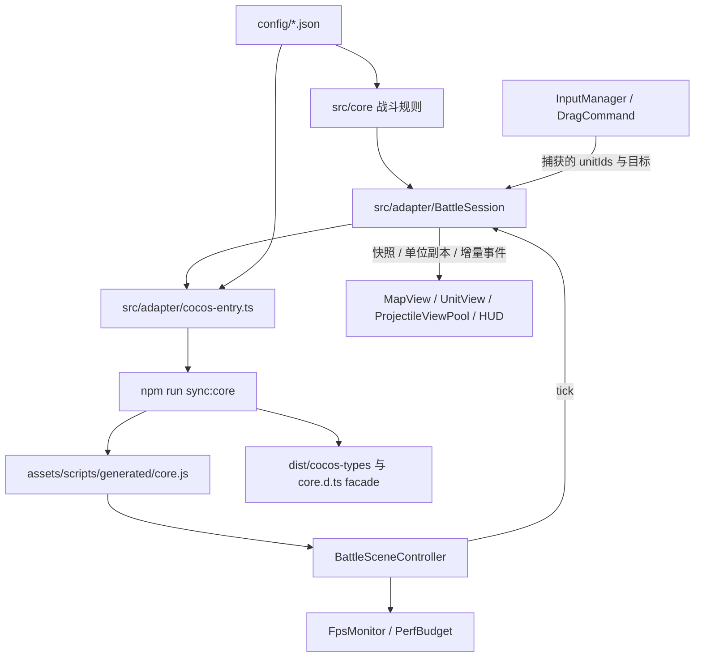

# 实际架构

> 场景扩展更新：入口现有故事模式与场景演练，故事顺序为小屋→大楼楼下，每关三波。地点内容集中于 `src/scenes/`，统一提供地图、波次和视觉数据；`BattleSession` 管理入口状态与章节推进，`MapView`、`InputManager`、`CommandSystem` 统一读取当前战斗地图。旧文中未来主菜单/单关范围已由本次实现替代，详见 [场景设计稿](10-story-scenes-design.md)。

> 当前实现：小屋僵尸从中央走廊出生，楼下僵尸从地图四边进入；僵尸沿墙角路线追击，路线被关闭房门挡住时先破门。七人小队包含两名范围喷火兵；小屋与楼下分别配置 700/270 只僵尸。3秒布阵不可跳过，Creator 导入、构建和设备表现仍待人工验证。规则细节见 [故事场景](10-story-scenes-design.md) 与 [手测表](testing/cocos-manual-checklist.md)。

[返回首页](../README.md) · [开发指南](development.md) · [历史设计索引](README.md)

本文描述现有实现；设计文档中的未来 ECS、主菜单、独立结算场景、存档等不代表已交付。

## 源码与生成边界



`src/core` 与 `config/*.json` 是战斗规则的权威源码，`src/adapter` 是无引擎会话桥，`assets/scripts/adapter` 是真正依赖 `cc` 的输入和表现层。生成包内的 BattleSession 是源码会话的打包结果，图中的调用边通过这个生成包发生，不是编辑器直接跨目录引用第二套规则。

唯一正常生成入口是 [sync-cocos-core.mjs](../scripts/sync-cocos-core.mjs)：esbuild 内联 JSON，输出 ES2018 浏览器 ES module；TypeScript 发出声明，再生成类型 facade。`core.js`、`core.d.ts` 和 `dist` 被忽略，不能手改或当作第二套可维护核心。`core.js.meta`、场景和脚本 `.meta` 保留资产身份；修改源或配置后必须同步，让 AssetDB 重导入。运行时不依赖 Node 或全局 `structuredClone`，核心的 JSON 数据副本使用 `cloneData`。

## 模块职责

| 模块 | 当前职责 |
|---|---|
| [BattleTestHarness](../src/core/BattleTestHarness.ts) | start、50ms 时钟、系统编排、快照、完整及游标事件、终局冻结 |
| [MapModel](../src/core/MapModel.ts) / [WaveManager](../src/core/WaveManager.ts) / SpawnSystem | 墙体与房门碰撞、墙角路径、场景出生点、按时开启波次并分批生成 |
| [UnitStore](../src/core/UnitStore.ts) | 单位 ID、存活筛选、死亡、清理与对象复用 |
| [CommandSystem](../src/core/CommandSystem.ts) / [MovementSystem](../src/core/MovementSystem.ts) | 固定半径选择、ID 校验、替换目标、个人紧凑落点、绕墙移动与到达 |
| [CombatSystem](../src/core/CombatSystem.ts) | 每步选择可达目标、沿墙角追击、攻击挡路房门、近战及唯一伤害/死亡权威；喷火范围伤害由弹道到达处理 |
| [ProjectileSystem](../src/core/ProjectileSystem.ts) | 核心飞行时间、整段墙体碰撞与到达事件；命中前再次验证遮挡，目标已死或躲入掩体不扣血 |
| [ResultSystem](../src/core/ResultSystem.ts) | 人类全灭优先失败，否则全波出完且无僵尸、有人类时胜利 |
| [BattleSession](../src/adapter/BattleSession.ts) | 暂停、重启、引擎 elapsed 桥接、事件游标、单兵命令 |
| [BattleSceneController](../assets/scripts/adapter/BattleSceneController.ts) | 动态 Canvas/Camera、生命周期、布局、tick/draw、后台暂停、统计 |
| [InputManager](../assets/scripts/adapter/InputManager.ts) / [contracts](../assets/scripts/adapter/contracts.ts) | UI 坐标转换、手势所有权、captured IDs、阈值/冷却、取消与 HUD 排除 |
| MapView / UnitView / ProjectileViewPool / HudController | 地图、单位与只读 AI 目标、共享 Graphics 弹道/闪光、HUD/结果卡；不决定伤害 |
| FpsMonitor / PerfBudget | 有界墙钟窗口、CPU 提交耗时、最近命令反馈、池占用；不改变玩法 |

## 时间与更新流

`start()` 重置战斗状态，进入默认 3 秒布阵；布阵中只执行人类移动，战斗钟停在 0。正常自动结束布阵时派发第一波。

`advance(seconds)` 累加 elapsed，战斗只消费完整 0.05s 步长；不足一帧留在累加器，快照是最后完成的 tick，不是调用结束时刻。时钟取整数 `battleTick / 20`，避免重复浮点加法漂移。每步先检查当前时刻到期波次，再发布新的帧时间，依次执行：

```text
Combat（含僵尸移动与近战）
  → 人类 Movement
  → Projectile 到达与伤害验证
  → 新时刻到期的 Waves
  → Result
```

新生成波次不会获得本帧之前的追溯移动。命令在当前已完成 tick 立即应用、下一步执行移动。一般事件使用同帧战斗钟，子弹到达可使用精确帧内时间；事件按产生顺序追加，不保证所有时间戳严格单调排序。终局后的 advance 不再改变快照、单位或事件；restart 清除前局会话游标和表现状态。seed 参数保留，当前战斗不使用随机数，所以多个种子不是随机覆盖证明。

BattleSession 接受完整 elapsed，但 controller 每次 update 将传入 dt 截到 50ms：卡顿时游戏时间会慢于墙钟，不能把会话的分段等价测试解释为长卡顿补时或帧率保障。MVP不支持跳过布阵；显式 `endDeployment()` 只保留为内部测试工具，其布阵余量边界保留为历史内部工具限制，不是玩家功能待修项。

## 输入到命令

每次按下时 InputManager 仅在半径 112px 内重新捕获距离最近的存活士兵，不扩展到旧选中组，空地拖动不框选。DragCommand 复制单个 `unitId` 并保存主触点；UnitView 按这个 ID 绘制选中兵的圈。释放经过阈值/UI/冷却检查后，调用 `BattleSession.moveGroup` → `issueMoveGroup`，核心去重并滤除死亡、敌方及无效 ID，钳制目标并给该士兵分配松手点附近的个人落点。落点避开墙体；不在原按下坐标重新空间查询。

MapModel 为不同单位半径缓存墙角可见图，以最短距离选择下一路点；目标距离缓存有64项上限。每步按当前目标重算方向，士兵也共用绕墙规则。僵尸对贴墙士兵使用可行走的接近点，避免7px/8px体型差异将目标误判为不可达；翻墙中的单位不参与分离推力，完成后恢复。

无渲染 `issueMoveAt` 仍提供调用瞬间的空间选择，用于验收固定战术；两者最终共用核心身份命令校验。

## 状态到画面

`getSnapshot()`、`getUnits()` 提供隔离副本。核心保留本局完整历史；会话用 `readEvents(cursor)` 仅拷贝新事件，重启后游标归零。渲染弹道根据 spawned/hit/blocked/expired 事件维护共享 Graphics 飞行轨迹、枪口闪光、命中后0.10s残留弹道与墙面火花，不建每弹一个 Node，不碰核心 HP；不是另一套命中系统。

逻辑地图左上原点、y 向下，UI/Graphics y 向上；输入用 `getUILocation()`，contracts 在同一适配框转换。SHOW_ALL 保持 1080×2400 完整地图，另按安全区预留 HUD。真实摄像机、Canvas、安全区、Label/Graphics 行为还须 Creator 与设备验证。

统计的 presentationMs 只到适配层 draw submission，反馈结束于下一次适配层绘制完成，不包含 GPU/显示，也不是触摸到光子的延迟。20 局生命周期回归只比较渲染根的直接子节点数和缓存计数，不能证明整个节点树或堆/GPU 内存稳定。
